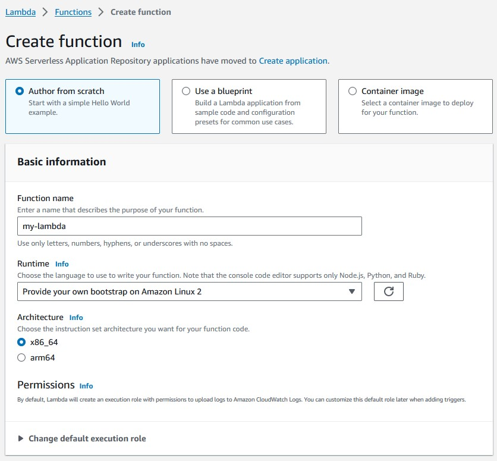
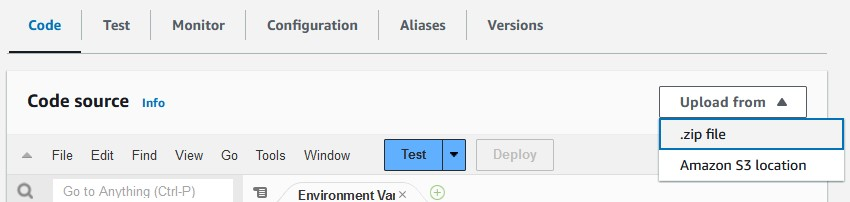
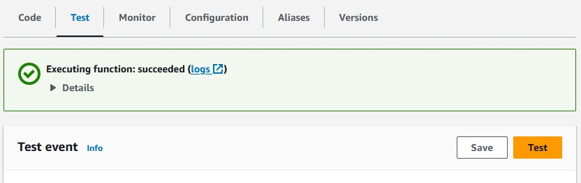
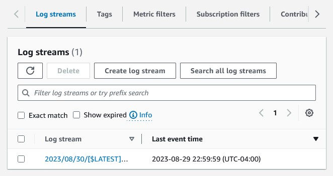
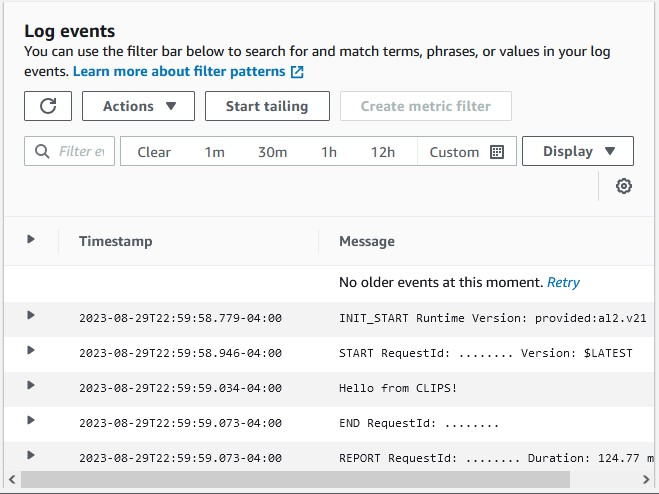
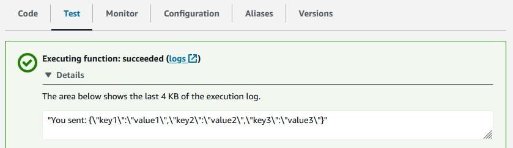

title: Run CLIPS in a C++ AWS Lambda
description: This article describes how to run a CLIPS program from an AWS Lambda function.
date: 2023-08-29
css: syntax.css articles/run-clips-in-a-cplusplus-aws-lambda.css
---
### Introduction

Lambda is a feature included with AWS that allows users to write a function
that runs without an EC2 instance. You can write these functions in many
different languages, and AWS provides the "environment" in which they'll
run. [CLIPS](https://www.clipsrules.net/) is written in C, so in order to
use CLIPS in an AWS Lambda, we must use the [C++ Lambda
Runtime](https://aws.amazon.com/blogs/compute/introducing-the-c-lambda-runtime/).
This article will step you through creating an AWS Lambda function that can
run your C(++) code.

### Creating the Lambda {#creating-the-lambda}

    <figure>
      <a href="run-clips-in-a-cplusplus-aws-lambda.jpg">
        
      </a>
      <figcaption>
        Creating a Lambda in the AWS Console. Make sure you select "Provide your own bootstrap on Amazon Linux 2"
        as your Runtime.
      </figcaption>
    </figure>

First, go to the Lambda section of your AWS Console. Then, click the "Create
function" button. From here, provide a name for your function, and select
"Provide your own bootstrap on Amazon Linux 2" as your Runtime. Then, click
the "Create function" button at the bottom of this page.

    <figure>
      <a href="run-clips-in-a-cplusplus-aws-lambda-2.jpg">
        
      </a>
      <figcaption>
        Clicking the 'Upload from' dropdown menu will display the '.zip file' option.
      </figcaption>
    </figure>

Below the "Function overview" section, you should see that the "Code" tab is
selected. Click "Upload from" dropdown menu, then select ".zip file." The
compilation process will create a zip file that we'll upload here.

Ok, now to the fun part: writing the code.

### Time to Code!

I'll reiterate the steps listed in the [C++ Lambda
Runtime](https://aws.amazon.com/blogs/compute/introducing-the-c-lambda-runtime/).
to install the AWS C++ SDK. You'll want to clone the repo from GitHub,
compile it, then install it. You'll need `cmake`, `git`, `make`, and the
`curl` development headers on the computer you're compiling the SDK on.
You'll run these commands from the command line:

```
$ cd ~
$ git clone https://github.com/awslabs/aws-lambda-cpp.git
$ cd aws-lambda-cpp
$ mkdir build
$ cd build
$ cmake .. -DCMAKE_BUILD_TYPE=Release -DBUILD_SHARED_LIBS=OFF \
   -DCMAKE_INSTALL_PREFIX=~/out
$ make && make install
```

Now make a directory where you'll write your C++ lambda and `cd` into it:

```
$ mkdir ~/my-lambda
$ cd ~/my-lambda
```

Download, extract, and compile the CLIPS source code:

```
$ wget https://sourceforge.net/projects/clipsrules/files/CLIPS/6.4.1/clips_core_source_641.tar.gz
# ... truncated output ...
HTTP request sent, awaiting response... 302 Found
Location: https://master.dl.sourceforge.net/project/clipsrules/CLIPS/6.4.1/clips_core_source_641.tar.gz?viasf=1 [following]
--2023-08-29 11:48:17--  https://master.dl.sourceforge.net/project/clipsrules/CLIPS/6.4.1/clips_core_source_641.tar.gz?viasf=1
Resolving master.dl.sourceforge.net (master.dl.sourceforge.net)... 216.105.38.12
Connecting to master.dl.sourceforge.net (master.dl.sourceforge.net)|216.105.38.12|:443... connected.
HTTP request sent, awaiting response... 200 OK
Length: 1081836 (1.0M) [application/x-gzip]
Saving to: ‘clips_core_source_641.tar.gz’

clips_core_source_641.tar.gz                    100%[====================================================================================================>]   1.03M  1.06MB/s    in 1.0s

2023-08-29 11:48:24 (1.06 MB/s) - ‘clips_core_source_641.tar.gz’ saved [1081836/1081836]
$ tar --strip-components=2 -xvf clips_core_source_641.tar.gz
# ... truncated output ...
$ make release_cpp
# ... truncated output ...
```

You should now have a `libclips.a` file in your current directory. This is
the file we'll use to bring CLIPS into our C++ lambda. Make a
`CMakeLists.txt` file with the following code in it:

```cmake
cmake_minimum_required(VERSION 3.5)
set(CMAKE_CXX_STANDARD 11)
project(my-lambda LANGUAGES CXX)

find_package(aws-lambda-runtime REQUIRED)
add_executable(${PROJECT_NAME} "main.cpp")
target_link_libraries(${PROJECT_NAME} PUBLIC ${CMAKE_SOURCE_DIR}/libclips.a)
target_link_libraries(${PROJECT_NAME} PUBLIC AWS::aws-lambda-runtime)
aws_lambda_package_target(${PROJECT_NAME}) 
```

Our `main.cpp` file will use the C++ code described in the official AWS
documentation, but we'll also bring in CLIPS:

```cpp
#include <aws/lambda-runtime/runtime.h>
#include "clips.h"

using namespace aws::lambda_runtime;

invocation_response my_handler(invocation_request const& request)
{
   Environment *mainEnv = CreateEnvironment();

   BatchStar(mainEnv, "program.bat");

   Run(mainEnv, -1);

   DestroyEnvironment(mainEnv);

   return invocation_response::success("ok", "text/plain");
}

int main()
{
   run_handler(my_handler);
   return 0;
}
```

Our program relies upon loading a `program.bat` file. Create that file in
the same directory as your `main.cpp` file so that it looks like this:

```clips
(println "Hello from CLIPS!")
```

In order to include this in the `.zip` file that'll be created when we
compile our program, we'll need to edit the
`~/out/lib/aws-lambda-runtime/cmake/packager` file slightly. Scroll towards
the bottom of this file, then add a single line:

```bash focus={4}
chmod +x "$PKG_DIR/bootstrap"
# some shenanigans to create the right layout in the zip file without extraneous directories
pushd "$PKG_DIR" > /dev/null
cp ../../program.bat .
zip --symlinks --recurse-paths "$PKG_BIN_FILENAME".zip -- *
ORIGIN_DIR=$(dirs -l +1)
mv "$PKG_BIN_FILENAME".zip "$ORIGIN_DIR"
popd > /dev/null
rm -r "$PKG_DIR"
echo Created "$ORIGIN_DIR/$PKG_BIN_FILENAME".zip
```

Now we'll compile it and create our `.zip` file:

```
$ mkdir build
$ cd build
$ cmake .. -DCMAKE_BUILD_TYPE=Release -DCMAKE_PREFIX_PATH=~/out
$ make
$ make aws-lambda-package-my-lambda
```

You should now have a `my-lambda.zip` file in your current directory. Upload
this file via the AWS console as detailed in the [Creating the Lambda
section of this article](#creating-the-lambda).

### Testing Things Out

    <figure>
      <a href="run-clips-in-a-cplusplus-aws-lambda-3.jpg">
        
      </a>
      <figcaption>
        Clicking the "Test" button under the "Test" tab will report back with a success or failure.
      </figcaption>
    </figure>

After we've uploaded our `.zip` file, we can finally test things out.
Navigating to the "Test" tab under the "Function overview" section presents
a "Test" button. Click this button to run the test. You should see a success
message. If you open this message, you'll see that our lambda returned "ok."
Clicking the "logs" link in that same message window sends us to the
CloudWatch logs for this lambda.

    <figure>
      <a href="run-clips-in-a-cplusplus-aws-lambda-4.jpg">
        
      </a>
      <figcaption>
        Checking out the logs of our lambda function
      </figcaption>
    </figure>

Click the first link in the table presented on this screen to see the output
of our CLIPS program.

    <figure>
      <a href="run-clips-in-a-cplusplus-aws-lambda-5.jpg">
        
      </a>
      <figcaption>
        The output of our CLIPS program run in the Lambda
      </figcaption>
    </figure>

There's the output of our CLIPS program! You can see the text we printed out
using `println` in our `program.bat` file on the third log line. Now we'll
talk about how to read the http request and write the response body from
within CLIPS.

### Reading and Writing, CLIPS to Lambda

We can add different I/O methods to our CLIPS program by adding a "Router."
I discussed what a CLIPS Router is and how to do this in [a previous
article](./a-simple-tcp-server-written-in-go-and-clips.html), so we'll move
right on to implementation. Update your `main.cpp` file so that it has two
new Routers: one for reading the request, the other for writing the
response.

```cpp focus={1-2,8-10,12-15,17-19,21-29,31-36,42,44-48,50-57,59:1-3,65-66}
#include <string>
#include <sstream>
#include <aws/lambda-runtime/runtime.h>
#include "clips.h"

using namespace aws::lambda_runtime;

bool QueryOutCallback(Environment *env, const char *logicalName, void *_) {
  return strcmp(logicalName, "lambda-out") == 0;
}

void WriteOutCallback(Environment *env, const char *logicalName, const char *str, void *context) {
  std::stringstream *ss = (std::stringstream*)context;
  *ss << str;
}

bool QueryInCallback(Environment *env, const char *logicalName, void *_) {
  return strcmp(logicalName, "lambda-in") == 0;
}

int ReadInCallback(Environment *env, const char *logicalName, void *context) {
  invocation_request *request = (invocation_request*)context;
  char toReturn = '\n';
  if(!request->payload.empty()) {
    toReturn = request->payload.front();
    request->payload.erase(request->payload.begin());
  }
  return toReturn;
}

int UnreadInCallback(Environment *env, const char *logicalName, int c, void *context) {
  char c_char = (char)c;
  invocation_request *request = (invocation_request*)context;
  request->payload = c_char + request->payload;
  return c;
}

invocation_response my_handler(invocation_request const& request)
{
   Environment *mainEnv = CreateEnvironment();

   std::stringstream ss;

   AddRouter(
     mainEnv, "lambda-out", 20,
     QueryOutCallback,
     WriteOutCallback,
     NULL, NULL, NULL, &ss);

   AddRouter(
     mainEnv, "lambda-in", 20,
     QueryInCallback,
     NULL,
     ReadInCallback,
     UnreadInCallback,
     NULL,
     const_cast<void *>((const void *)(&request)));

   BatchStar(mainEnv, "program.bat");

   Run(mainEnv, -1);

   DestroyEnvironment(mainEnv);

   //return invocation_response::success("ok", "text/plain");
   return invocation_response::success(ss.str(), "text/plain");
}

int main()
{
   run_handler(my_handler);
   return 0;
}
```

`QueryOutCallback` and `QueryInCallback` are simple: if the Router CLIPS
attempts to `printout` to or `readln` from is called `lambda-out` or
`lambda-in` respectively, we'll use this Router's callback functions.
`WriteOutCallback` is how we'll write our http response. Its last argument
`context` is a void pointer. We cast it to a `std::stringstream` so we can
use it as a buffer. We'll eventually write the contents of this
`std::stringstream` to the response body of our lambda function.

`ReadInCallback` also receives a `context` void pointer. This is the request
as sent in to the lambda handler, so we can cast it as `invocation_request`.
We'll read the payload character by character. An `invocation_request` has a
property `payload` which is a `std::string`, so we can use `empty` to make
sure it's not empty before "shifting" the first character from the string
with `front`, `erase`, and `begin`. `UnreadInCallback` should do the
opposite: it puts the second `const char` argument back on to the front of
the string.

In `my_handler`, we add two calls to `AddRouter` to add our new Routers.
Note the funky casting we have to do for the `context` argument of the
`lambda-in` Router function. That's because the `invocation_request` is a
`const`; we must first cast to a `const void` pointer before casting to a
`void` pointer.

Finally, we replace the hard coded `"ok"` with `ss.str()` in our
`invocation_response::success` call. This will return the contents of our
`std::stringstream` buffer we wrote to in `WriteOutCallback`.

One final touch: we'll replace the contents of our `program.bat` file so
that it uses these two new routers:

```clips
(printout lambda-out "You sent: " (readline lambda-in))
```

This is effectively an echo server demonstrating how to get the request and
write the response from within your CLIPS program. From inside of your
`build` directory, follow the previous compilation steps to generate a new
`.zip` file:

```
$ make clean
$ make
$ make aws-lambda-package-my-lambda
```

Upload the new `.zip` file as described in our previous steps. Now we'll
click that "Test" button:

    <figure>
      <a href="run-clips-in-a-cplusplus-aws-lambda-6.jpg">
        
      </a>
      <figcaption>
        Our CLIPS program reading the request body sent to Lambda and writing to the http response
      </figcaption>
    </figure>

Voila!

### Conclusion

In this article, we demonstrated how to use CLIPS from within an AWS lambda.
We learned how to add Routers to CLIPS so that our Rules Engine could read
the http request made to the lambda as well as write to the http response of
the lambda. I hope this was helpful for you!

\- ryjo
